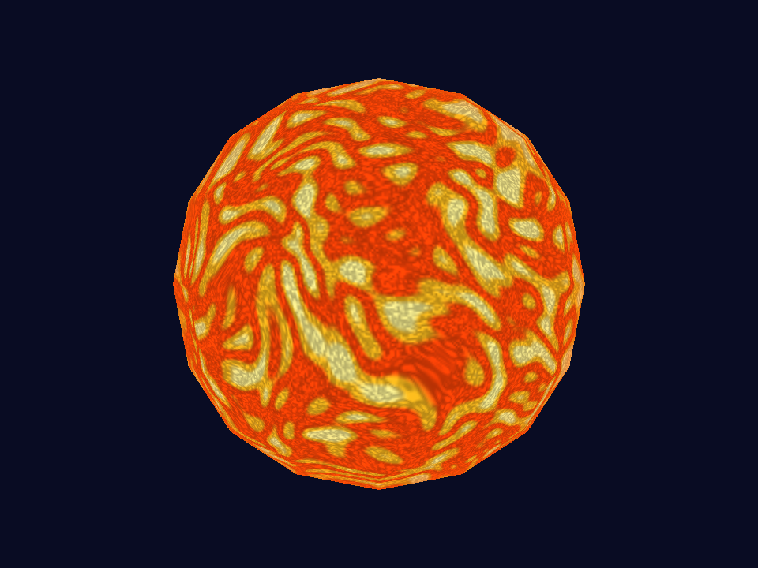
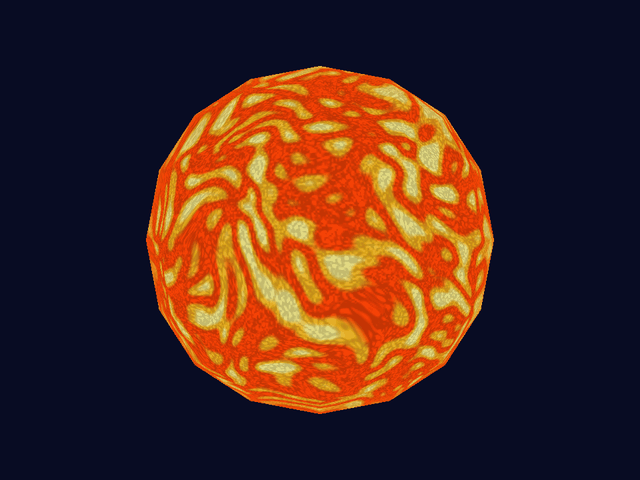
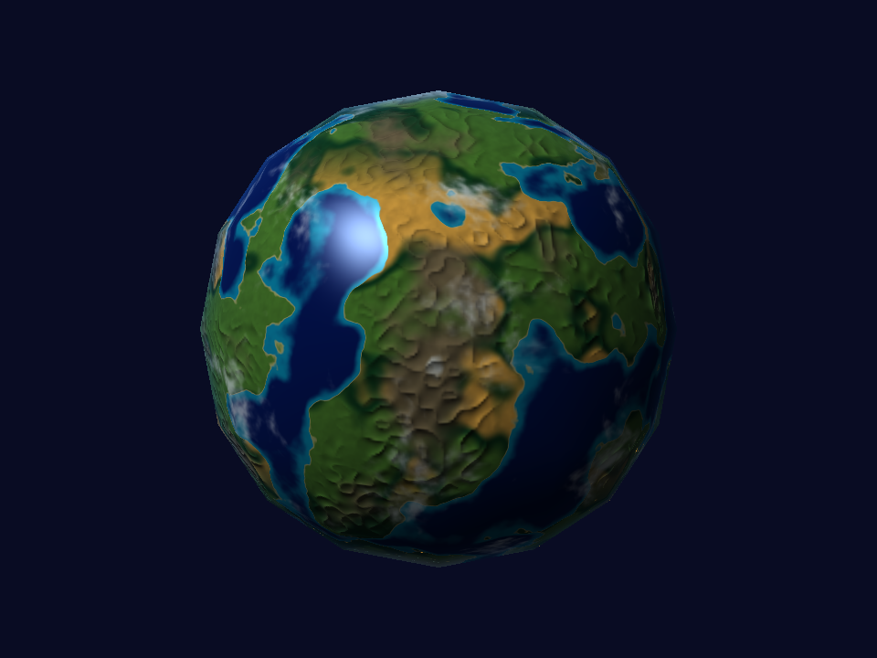
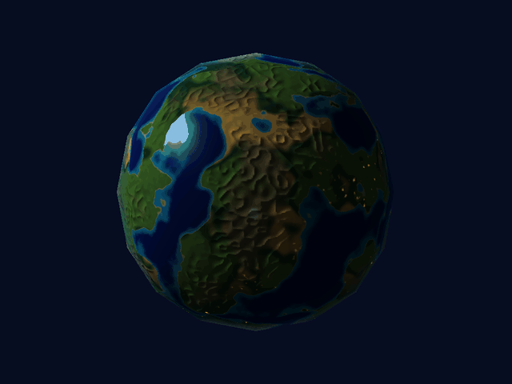
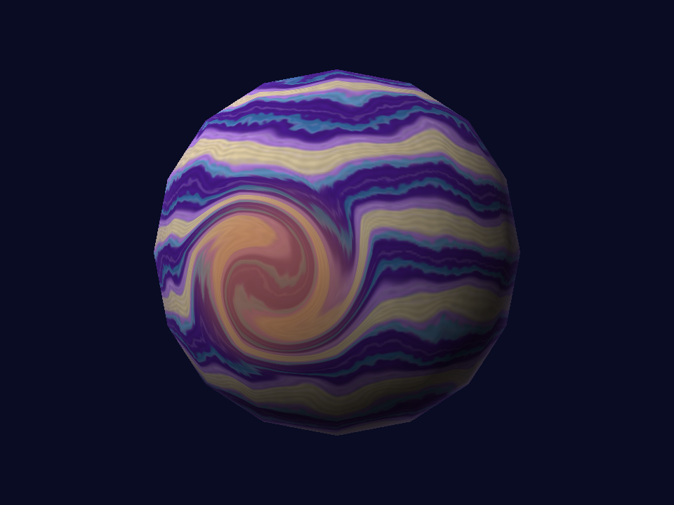
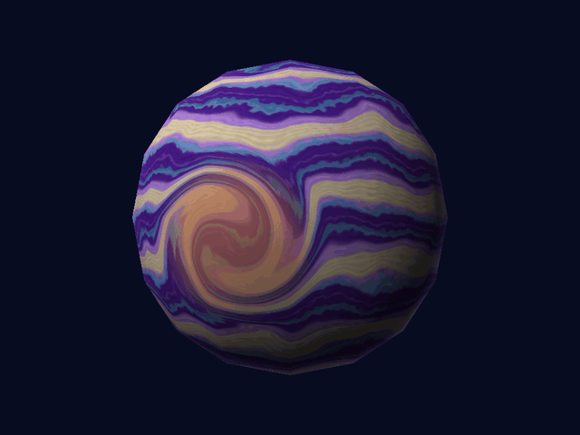
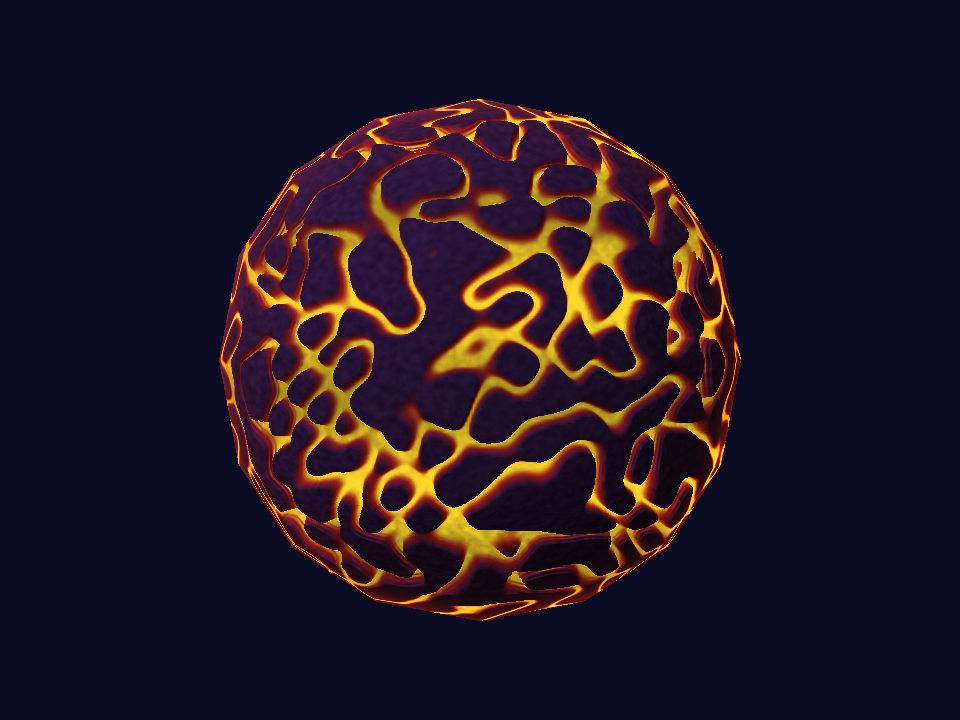
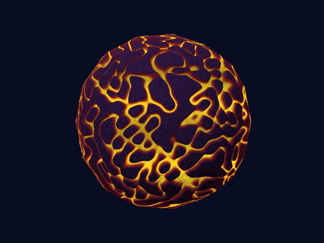
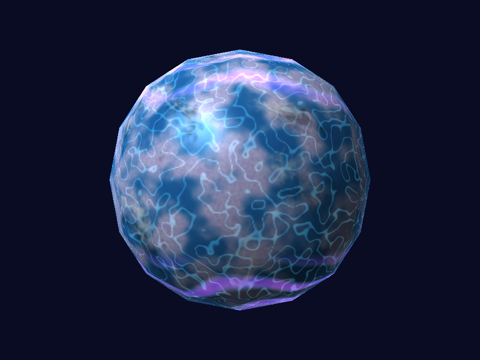
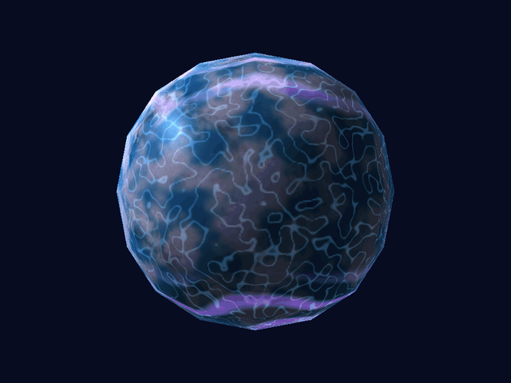

# Laboratorio 6: Shaders

Cinco cuerpos celestes renderizados en CPU con la esfera proporcionada en
`assets/models/sphere.obj`. Todos usan la misma geometría, sin modificar sus
vértices. Los colores y efectos se generan con funciones matemáticas y ruido
OpenSimplex, sin imágenes como texturas ni materiales externos. Raylib presenta
el framebuffer calculado por la CPU.

## Compilación y ejecución

Requisitos:

- Rust estable con soporte para la edición 2024 y Cargo.
- CMake y un compilador C/C++ para compilar Raylib. En Windows, Visual Studio
  Build Tools con las herramientas de C++ y el SDK de Windows.

Desde la carpeta `lab-6-graficas`:

```sh
cargo build --release
cargo run --release
```

Cargo instala las dependencias de `Cargo.toml`. El planeta rocoso se selecciona
al iniciar.

## Controles

| Tecla | Acción |
| --- | --- |
| `1` | Seleccionar la estrella |
| `2` | Seleccionar el planeta rocoso |
| `3` | Seleccionar el gigante gaseoso |
| `4` | Seleccionar el planeta volcánico |
| `5` | Seleccionar el planeta helado |
| `W` / `S` | Orbitar verticalmente |
| `A` / `D` | Orbitar horizontalmente |
| Flechas arriba / abajo | Acercar / alejar la cámara |
| `J` / `L` | Girar la luz |
| Espacio | Pausar o reanudar la animación |
| `N` | Activar o desactivar la visualización de normales |
| `E` | Activar o desactivar reflejos en el planeta rocoso y el helado |
| `C` | Activar o desactivar nubes en el planeta rocoso y el helado |
| `Z` / `X` | Reducir / aumentar la cobertura de nubes |
| `V` | Activar o desactivar luces nocturnas en el planeta rocoso |
| `B` | Activar o desactivar relieve en el planeta rocoso y el volcánico |
| `T` | Activar o desactivar el vórtice del gigante gaseoso |
| `P` | Activar o desactivar el parallax del planeta volcánico |
| `H` | Activar o desactivar las sombras de nubes del planeta helado |
| `U` | Activar o desactivar las auroras del planeta helado |
| `R` | Reiniciar cámara, luz y tiempo; reanudar y desactivar normales |
| `Esc` | Salir |

La pausa permite seguir moviendo la cámara y la luz. El reinicio conserva el
shader seleccionado y los interruptores de sus efectos.

## Shaders

Los campos procedurales se calculan al iniciar y se consultan con interpolación
bilineal desde los fragment shaders. La iluminación y los desplazamientos que
dependen de la cámara, la luz o el tiempo se calculan por cuadro. Después de
cambiar una constante del material, se debe recompilar y reiniciar el programa.

### Estrella



Superficie naranja y amarilla con celdas, manchas oscuras y granulación.
En `src/star.rs`, `material` deforma las coordenadas con ruido y usa su valor
absoluto para separar las celdas. Mezcla los colores según la temperatura
aparente, superpone manchas de ruido fractal y añade ruido de mayor frecuencia
para la granulación. `shade` deforma las coordenadas con el tiempo sin mover
la esfera. El color no depende de la luz externa.

| Parámetro en `star.rs` | Efecto visual |
| --- | --- |
| `CELL_FREQUENCY = 9.0` | Al aumentarlo, las celdas son más pequeñas |
| `WARP_STRENGTH = 0.35` | Controla la deformación del patrón |
| `SPOT_THRESHOLD = 0.64` | Al aumentarlo, aparecen menos manchas |
| `FLOW_SPEED = 0.18` | Controla la velocidad de la animación |



### Planeta rocoso



Océanos azules, continentes verdes, desiertos, montañas, hielo y nubes blancas.
En `src/rock.rs`, `height_at` combina ruido fractal deformado con frecuencias
altas para definir continentes y costas. `shade` compara la altura con el nivel
del mar y mezcla los materiales según altura, humedad y latitud. El agua tiene
reflejos especulares y la tierra permanece mate. Las pendientes modifican las
normales para producir relieve. `src/night.rs::emission` añade luces sobre
zonas terrestres bajas únicamente en el lado nocturno.

`src/clouds.rs::prepare` combina ruido amplio y fino para las nubes. `blend`
aplica una máscara de cobertura que gira independientemente del terreno.

| Parámetro | Efecto visual |
| --- | --- |
| `rock.rs::CONTINENT_FREQUENCY = 2.8` | Controla el tamaño de los continentes |
| `rock.rs::SEA_LEVEL = 0.49` | Al aumentarlo, crece la superficie cubierta por agua |
| `rock.rs::SNOW_HEIGHT = 0.67` | Define la altura a partir de la cual aparece nieve |
| `rock.rs::BUMP_STRENGTH = 0.018` | Controla la intensidad del relieve |
| `rock.rs::WATER_SHININESS = 72.0` | Al aumentarlo, el reflejo del agua es más concentrado |




### Gigante gaseoso



Bandas violetas, lilas y claras con líneas secundarias y una tormenta localizada.
En `src/gas.rs`, `material` combina una onda por latitud con ruido que deforma
las bandas. Otras ondas y ruido fino añaden filamentos. `vortex` gira las
coordenadas alrededor de un centro y reduce la deformación hasta cero en su
borde. `shade` desplaza cada latitud a distinta velocidad y aplica iluminación.

| Parámetro en `gas.rs` | Efecto visual |
| --- | --- |
| `BAND_FREQUENCY = 22.0` | Al aumentarlo, aparecen más bandas |
| `DISTORTION = 2.6` | Controla cuánto se deforman las bandas |
| `VORTEX_RADIUS = 0.48` | Controla la extensión angular de la tormenta |
| `VORTEX_STRENGTH = 4.5` | Controla cuánto giran los patrones dentro de la tormenta |
| `FLOW_SPEED = 0.10` | Controla la velocidad del desplazamiento |



### Planeta volcánico



Corteza violeta separada por grietas de lava naranja y amarilla.
En `src/volcanic.rs`, `terrain` obtiene grietas del valor absoluto de un ruido
deformado y calcula la altura de la corteza. `shade` ilumina la roca, modifica
sus normales con las pendientes y mezcla la lava emisiva, cuyo brillo varía
con el tiempo. `displaced` recorre capas del campo de altura en la dirección
de la vista para desplazar los detalles mediante parallax.

| Parámetro en `volcanic.rs` | Efecto visual |
| --- | --- |
| Umbrales `0.025` y `0.14` de `cracks` | Controlan el ancho y la transición de las grietas |
| `DEPTH = 0.075` | Controla la profundidad aparente del parallax |
| `STEPS = 6` | Controla la cantidad de capas recorridas para encontrar la superficie |
| Factor `1.7` de `pulse` | Controla la velocidad de variación del brillo de la lava |



Primero se mueve
la cámara con el tiempo congelado, después se anima el brillo de la lava con
la cámara fija.

### Planeta helado



Hielo azul y lila, zonas de nieve, grietas luminosas y auroras verdes y violetas.
En `src/frozen.rs`, `prepare` genera los campos de hielo, fracturas y grano.
`shade` mezcla lagos y escarcha según la altura, añade reflejos y emisión en
las grietas, y dibuja auroras con ondas limitadas a las regiones polares.
Las nubes usan el campo de `src/clouds.rs`. Su función `shadow` proyecta un
rayo hacia la luz, consulta ese mismo campo a la altura de las nubes y atenúa
la iluminación directa y los reflejos de la superficie.

| Parámetro | Efecto visual |
| --- | --- |
| Umbrales `0.42` y `0.58` de `snow` en `frozen.rs` | Controlan la distribución de nieve |
| Amplitud `0.48` de `aurora` en `frozen.rs` | Controla el brillo de las auroras |
| Radio `0.93` en `clouds.rs::cloud_intersection` | Controla la altura de las nubes y la separación de las sombras |
| Atenuación `0.65` en `clouds.rs::shadow` | Controla la oscuridad de las sombras |



Primero cambia
la dirección de la luz con el tiempo congelado; después se animan las nubes y
las auroras con luz fija.

## Efectos adicionales

| Efecto | Cuerpo | Archivo y función | Funcionamiento, parámetro y evidencia |
| --- | --- | --- | --- |
| Material animado | Estrella | `src/star.rs::shade` | Deforma las coordenadas del plasma con el tiempo sin mover la geometría. `FLOW_SPEED` controla la velocidad. [GIF](assets/captures/estrella.gif). |
| Apariencia de día y noche | Planeta rocoso | `src/night.rs::emission` | La orientación respecto a la luz activa la emisión de ciudades en la noche. `LIGHT_STRENGTH = 1.4` controla su brillo. [GIF](assets/captures/rocoso-luz.gif). |
| Respuestas diferentes a la iluminación | Planeta rocoso | `src/rock.rs::shade` | Una máscara limita el reflejo especular al agua. `WATER_SPECULAR = 0.85` controla su intensidad. [GIF](assets/captures/rocoso-luz.gif). |
| Nubes procedurales | Planeta rocoso | `src/clouds.rs::prepare`, `density_at` y `blend` | Mezcla ruido de dos escalas, aplica un umbral de cobertura y mueve las nubes sobre terreno fijo. `cloud_coverage` controla la cobertura; `CLOUD_SPEED = 0.07`, la velocidad. [GIF](assets/captures/rocoso-nubes.gif). |
| Tormenta o vórtice localizado | Gigante gaseoso | `src/gas.rs::vortex` y `shade` | Gira las coordenadas cerca del centro y reduce el giro hacia el borde, curvando las bandas. `VORTEX_STRENGTH` controla la deformación. [GIF](assets/captures/gaseoso.gif). |
| Relieve procedural mediante bump mapping | Planeta rocoso | `src/rock.rs::prepare` y `bumped_normal` | Calcula pendientes del campo de altura y modifica la normal usada para iluminar, sin cambiar vértices. `BUMP_STRENGTH` controla el relieve. [GIF](assets/captures/rocoso-luz.gif). |
| Parallax dependiente de la vista | Planeta volcánico | `src/volcanic.rs::displaced` | Recorre capas de altura e interpola la intersección para desplazar los detalles según la cámara. `DEPTH` controla la profundidad. [GIF](assets/captures/volcanico.gif). |
| Sombras de nubes | Planeta helado | `src/clouds.rs::cloud_intersection` y `shadow`; `src/frozen.rs::shade` | Proyecta el punto hacia la capa de nubes en dirección a la luz y usa su máscara para sombrear la superficie. El radio `0.93` controla la separación de las sombras. [GIF](assets/captures/helado.gif). |
